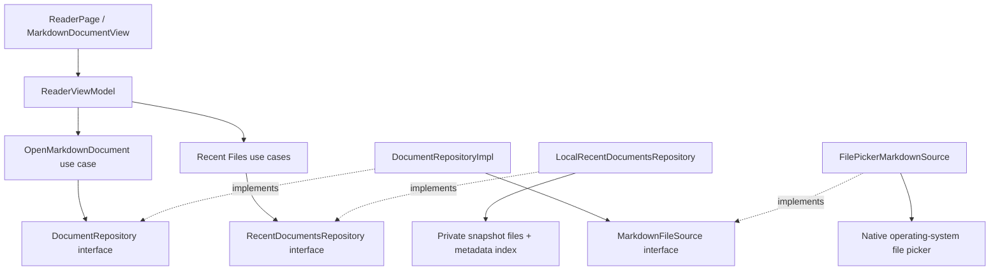
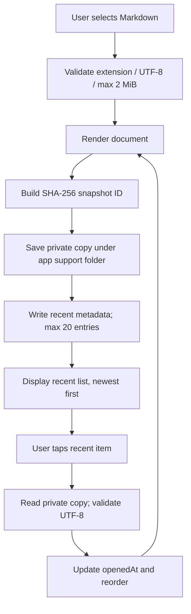

# Flutter Markdown Reader — Zero to Production

**MVVM + Clean Architecture · Offline-first · Android-first**

**Product engineering · Implementation blueprint · Version 1.1 · 20 October 2026**

This Markdown document is a conversion of the companion Word development guide. For the runnable example implementation, see `Flutter_Markdown_Reader_MVVM_Starter.zip` in the same folder.

# Document purpose

A practical guide to planning, implementing, testing, and releasing a Flutter application that picks a local Markdown (.md/.markdown) file, renders it as a readable, scrollable document, **and saves a persistent Recent Files list for one-tap offline reopening**. The companion ZIP contains the source files described here.

| Decision | Chosen implementation |
| --- | --- |
| Architecture | Feature-first Clean Architecture with MVVM in presentation |
| Interaction | Native device picker; user-initiated access and one-tap recent-file reopening |
| Data model | Immutable MarkdownDocument and RecentDocument entities; no backend/server |
| UI state | Riverpod `Notifier<ReaderState>` with document and recent-document list |
| Initial platform | Android (with optional other Flutter targets) |
| Security defaults | 2 MiB limit; strict UTF-8; app-private offline copies; external images/links disabled |

## Read this first

This is a production delivery plan and a code starter, not evidence of a production-approved binary. No Flutter SDK or device is available in the authoring environment; compilation and device verification must be completed before distribution. The new recent-file persistence adapter targets **Android/iOS/desktop**, and does not run on Flutter Web without a separate implementation.

# Contents

01  Scope and acceptance criteria

02  Tools, package versions and environment

03  Clean Architecture with MVVM

04  Feature-first file and directory structure

05  Runtime flow and domain contracts

06  Data source and repository implementation

07  ViewModel, UI state and Reader View

08  Recent Files: persistent history and one-tap reopening

09  Setup: zero to first run

10  Quality, error handling, privacy and performance

11  Automated tests and CI pipeline

12  Android release: signing, bundles and store

13  Production acceptance and rollout plan

14  Roadmap, limitations and reference links

# 01  Scope and acceptance criteria

Build the smallest reliable read-only Markdown reader, then add product features behind the same architecture. There is no authentication, analytics SDK, or backend API. Version 1.1 includes **local recent-file persistence** (a metadata index plus private snapshots), without a server or remote database.

## v1.1 capabilities

- Pick one .md or .markdown file using the OS document picker.
- Read content as strict UTF-8 and display GitHub-flavored Markdown.
- Support headings, bullets, tables, code blocks, quotes and selectable text.
- Display the filename, loading indicator and meaningful error banner.
- Handle picker dismissal without losing a previously opened document.
- Support dark/light themes from system settings.
- Operate without an internet connection or user account.
- Automatically remember the **20 most recently opened** Markdown documents.
- Display a Recent Files list on the empty reader screen, **quick-access chips above the currently opened Markdown**, and a full history drawer.
- Reopen a recent document with one tap without launching the file picker.
- Preserve the recent list across app restarts and reorder it when a document is reopened.
- Remove individual recent entries and clear all history without deleting original files.

## Explicit non-goals

- Editing files, saving files, or changing original storage content.
- Automatic synchronization with the original document after the saved snapshot was created.
- Retrieving remote assets or opening links automatically.
- Reading arbitrary-sized files or all file encodings.
- Publishing a pre-signed binary from this starter package.

## v1.1 acceptance tests

| ID | Test / expected result |
| --- | --- |
| AC-01 | Pick valid README.md: title and formatted content are visible. |
| AC-02 | Cancel picker: old document remains; no error. |
| AC-03 | Pick .txt via unusual provider: rejected by extension revalidation. |
| AC-04 | Pick malformed UTF-8: show friendly error and retain old document. |
| AC-05 | Pick > 2 MiB: reject with explanation; no large allocation. |
| AC-06 | Airplane mode: local Markdown still opens and renders. |
| AC-07 | Markdown image URL does not initiate a remote download. |
| AC-08 | Screen reader and large text can access controls and article. |
| AC-09 | Open README.md; file immediately appears at the top of Recent Files. |
| AC-10 | Terminate and relaunch app; recent entries are restored. |
| AC-11 | Tap recent item offline; Markdown opens without file picker. |
| AC-12 | Reopen an older recent item; it moves to the top of the list. |
| AC-13 | After the 21st unique snapshot, only 20 entries remain. |
| AC-14 | Remove/Clear recent history; cached copies disappear, originals remain intact. |
| AC-15 | Missing/corrupt recent copy shows a friendly error and retains the currently displayed document. |

# 02  Tools, package versions and environment

| Dependency | Baseline | Why |
| --- | --- | --- |
| Flutter SDK | Stable channel (Dart 3.12+) | Native cross-platform UI |
| flutter_riverpod | ^3.4.3 | ViewModel state and DI |
| file_picker | ^13.1.0 | Single native document picker + streamed bytes |
| flutter_markdown_plus | ^1.0.12 | GFM rendering in Flutter widgets |
| flutter_test | Flutter SDK | Unit/widget tests |
| flutter_lints | ^6.0.0 | Static analysis rules |
| path_provider | ^2.1.6 | Persistent app-private support directory |
| shared_preferences | ^2.5.6 | Small serialized recent-file metadata index (Async API) |
| crypto | ^3.0.7 | SHA-256 ID for stable deduplication of matching name + content |

> **Note:** Versions were checked against pub.dev on 20 October 2026. Riverpod 3.4.3 requires Dart 3.12; file_picker 13.x has breaking differences from 11.x tutorials. Commit the resolved pubspec.lock after flutter pub get for reproducible app builds.

## Windows development prerequisites

1. Install Flutter and add flutter/bin to PATH.
2. Install Android Studio and the Android SDK (including the licenses).
3. Install the Flutter and Dart IDE extensions if using VS Code.
4. Enable USB debugging on a physical Android device, or create an Android emulator.
5. Run flutter doctor -v and resolve issues affecting Android development.

```bash
flutter --version
dart --version
flutter doctor -v
flutter doctor --android-licenses
```

# 03  Clean Architecture with MVVM

Flutter recommends separating Views, ViewModels, repositories and services, and adding a domain/use-case layer when business logic warrants it. This project includes a small domain layer intentionally, because strong boundaries are the primary learning and maintainability goal.

| Layer | Classes | Rule |
| --- | --- | --- |
| Presentation | ReaderPage, MarkdownDocumentView, ReaderViewModel, ReaderState | Flutter widgets display the reader and recent list; ViewModel handles commands. |
| Domain | MarkdownDocument, RecentDocument, DocumentRepository, RecentDocumentsRepository, OpenMarkdownDocument, recent-document use cases | Pure Dart; no Flutter/plugin imports. |
| Data | DocumentRepositoryImpl, LocalRecentDocumentsRepository, MarkdownFileSource, FilePickerMarkdownSource | Implements contracts, decodes file and isolates plugin. |
| Composition | Riverpod provider registrations | Connect concrete classes without leaking them into domain. |

## Dependency direction

Views depend on the ViewModel. The ViewModel calls use cases, which depend on abstract repository contracts (`DocumentRepository` and `RecentDocumentsRepository`). Data implements those contracts; it may depend on domain. Dependencies are assembled in `reader_providers.dart`. UI-to-data flow is one-way through state updates.



## Do / avoid

| Do | Avoid |
| --- | --- |
| Put file_picker calls in FilePickerMarkdownSource. | Calling native pickers directly from ReaderPage. |
| Return immutable MarkdownDocument objects. | Passing PlatformFile to the UI or domain. |
| Perform file validation and UTF-8 parsing in repository. | Decoding raw bytes inside Widget build(). |
| Represent busy/error/document as ReaderState. | Using multiple mutable globals as UI state. |
| Mock repository/data-source boundaries in tests. | Requiring a real picker for unit tests. |

# 04  Feature-first file and directory structure

```text
markdown_reader/
  lib/
    main.dart
    app/app.dart
    core/errors/document_failure.dart
    features/reader/
      domain/
        entities/markdown_document.dart
        entities/recent_document.dart
        repositories/document_repository.dart
        repositories/recent_documents_repository.dart
        usecases/open_markdown_document.dart
        usecases/list_recent_documents.dart
        usecases/save_recent_document.dart
        usecases/open_recent_document.dart
        usecases/remove_recent_document.dart
        usecases/clear_recent_documents.dart
      data/
        datasources/markdown_file_source.dart
        datasources/file_picker_markdown_source.dart
        datasources/recent_index_store.dart
        repositories/document_repository_impl.dart
        repositories/local_recent_documents_repository.dart
      di/reader_providers.dart
      presentation/
        viewmodels/reader_state.dart
        viewmodels/reader_view_model.dart
        views/reader_page.dart
        widgets/markdown_document_view.dart
  test/features/reader/
    domain/open_markdown_document_test.dart
    domain/recent_documents_usecases_test.dart
    data/document_repository_impl_test.dart
    data/local_recent_documents_repository_test.dart
    presentation/reader_page_test.dart
  .github/workflows/flutter_ci.yml
  pubspec.yaml
  analysis_options.yaml
  example.md
  README.md
```

The ZIP intentionally excludes generated platform projects (android/, ios/, etc.). Flutter creates these for the current toolchain with flutter create .; the product-specific source lives entirely in lib/ and test/.

# 05  Runtime flow and domain contracts

1. User presses “Open Markdown file” in ReaderPage.
2. ReaderViewModel sets isLoading=true and executes OpenMarkdownDocument.
3. The repository invokes the native picker data source.
4. The user chooses or cancels a file. Cancellation returns null.
5. The data source enforces the 2 MiB cap while streaming bytes.
6. The repository checks extension, decodes UTF-8, returns MarkdownDocument.
7. ViewModel publishes a new immutable ReaderState.
8. ReaderPage rebuilds and MarkdownDocumentView renders the document.
9. The Recent Files panel now shows the newly opened file first; clicking it later invokes OpenRecentDocument without the picker.

## Core domain entity

```dart
class MarkdownDocument {
  const MarkdownDocument({
    required this.fileName,
    required this.content,
    required this.sizeInBytes,
  });

  final String fileName;
  final String content;
  final int sizeInBytes;
}
```

## Domain repository contract

```dart
import '../entities/markdown_document.dart';

abstract interface class DocumentRepository {
  /// Null means the user dismissed the native file picker.
  Future<MarkdownDocument?> pickAndRead();
}
```

## Use-case boundary

```dart
import '../entities/markdown_document.dart';
import '../repositories/document_repository.dart';

class OpenMarkdownDocument {
  const OpenMarkdownDocument(this._repository);

  final DocumentRepository _repository;

  Future<MarkdownDocument?> call() => _repository.pickAndRead();
}
```

# 06  Data source and repository implementation

The data source knows the external picker API; the repository owns app-oriented decoding and validation. Separate responsibilities make testing the domain and data behavior possible without platform-channel mocks.

## Data-source implementation: critical logic

```dart
import 'dart:typed_data';
import 'package:file_picker/file_picker.dart';
import '../../../../core/errors/document_failure.dart';
import 'markdown_file_source.dart';

class FilePickerMarkdownSource implements MarkdownFileSource {
  const FilePickerMarkdownSource();

  static const int maxBytes = 2 * 1024 * 1024;

  @override
  Future<PickedMarkdownData?> pick() async {
    final file = await FilePicker.pickFile(
      type: FileType.custom,
      allowedExtensions: const ['md', 'markdown'],
    );
    if (file == null) return null;

    // Validate metadata when available, then enforce size while streaming.
    final declaredSize = file.lengthSync() ?? await file.length();
    if (declaredSize != null && declaredSize > maxBytes) {
      throw const DocumentTooLargeFailure();
    }

    final builder = BytesBuilder(copy: false);
    await for (final chunk in file.readAsByteStream()) {
      if (builder.length + chunk.length > maxBytes) {
        throw const DocumentTooLargeFailure();
      }
      builder.add(chunk);
    }
    return PickedMarkdownData(name: file.name, bytes: builder.takeBytes());
  }
}
```

## Repository responsibilities

```dart
import 'dart:convert';
import '../../../../core/errors/document_failure.dart';
import '../../domain/entities/markdown_document.dart';
import '../../domain/repositories/document_repository.dart';
import '../datasources/markdown_file_source.dart';

class DocumentRepositoryImpl implements DocumentRepository {
  const DocumentRepositoryImpl(this._source);
  final MarkdownFileSource _source;

  @override
  Future<MarkdownDocument?> pickAndRead() async {
    try {
      final picked = await _source.pick();
      if (picked == null) return null;

      final lowerName = picked.name.toLowerCase();
      if (!lowerName.endsWith('.md') &&
          !lowerName.endsWith('.markdown')) {
        throw const UnsupportedFileFailure();
      }

      final text = utf8.decode(picked.bytes, allowMalformed: false);
      return MarkdownDocument(
        fileName: picked.name,
        content: text,
        sizeInBytes: picked.bytes.length,
      );
    } on DocumentFailure {
      rethrow;
    } on FormatException {
      throw const InvalidEncodingFailure();
    } catch (_) {
      throw const DocumentReadFailure();
    }
  }
}
```

> **Note:** If the file provider cannot determine a file length, the streamed byte counter still enforces the limit. A small maximum also reduces rendering/memory risk; it does not eliminate all resource-exhaustion threats from pathological Markdown.

# 07  ViewModel, UI state and Reader View

## UI state

```dart
import '../../domain/entities/markdown_document.dart';
import '../../domain/entities/recent_document.dart';

class ReaderState {
  const ReaderState({
    this.document,
    this.recentDocuments = const [],
    this.isLoading = false,
    this.errorMessage,
  });

  final MarkdownDocument? document;
  final List<RecentDocument> recentDocuments;
  final bool isLoading;
  final String? errorMessage;
}
```

## ViewModel: command lifecycle

The updated `ReaderViewModel` in the ZIP contains these public commands:

```dart
Future<void> refreshRecents();
Future<void> openFile();
Future<void> openRecent(String id);
Future<void> removeRecent(String id);
Future<void> clearRecents();
```

`openFile()` first uses the existing `OpenMarkdownDocument` use case, displays the validated document, then calls `SaveRecentDocument` and `ListRecentDocuments`. If the picker is cancelled, it does not add a history entry. If history persistence fails, the already opened document stays visible with a nonfatal warning.

`openRecent(id)` uses the app-private saved copy. On success, the index `openedAt` timestamp is updated so the document moves to the beginning of the list. Loading errors preserve the previously viewed document.

## Render strategy

ReaderPage watches the ViewModel provider. It provides an empty-screen Recent Files list, a horizontally scrollable one-tap recent-file strip while reading, a full history drawer, a Markdown view and an error banner. The previous document remains visible during subsequent file selections. Removing an entry from history does not close an already open document.

```dart
final state = ref.watch(readerViewModelProvider);
final openFile = ref.read(readerViewModelProvider.notifier).openFile;
// Render state.document and state.errorMessage.
// Disable the open action while state.isLoading.
```

The Markdown widget is configured selectable=true. Its imageBuilder returns a placeholder instead of loading the image, and onTapLink is left unset to avoid opening arbitrary untrusted links. A later version can add an explicit allowlist and a confirmation dialog.

# 08  Recent Files: persistent history and one-tap reopening

## User experience

After a successful pick, the app automatically adds the Markdown document to **Recent Files**. On the empty reader screen, entries appear beneath **Open Markdown file**. While reading, a **horizontal row of recent-document chips** gives one-tap switching; the **history icon** in the top bar opens the full list with remove/clear actions.

- Tap any recent entry to open it immediately without seeing a file picker.
- Show the newest opened file first; reopening an older item moves it to the top.
- Keep up to **20 entries**, surviving app restarts and functioning offline.
- Tap the remove icon on one item to delete that history entry and its private snapshot.
- Use **Clear all** (with confirmation) to remove all recent entries; original source files stay untouched.
- Cancellation of the file picker and failed imports do not add a history entry.
- An already displayed document remains visible if reopening a missing/corrupted snapshot fails.

## Why use a saved copy instead of a file path?

On Android and cloud-backed document providers, the URI, picker cache path or temporary permission may not remain valid after app restart. Saving an original-looking path to preferences does not guarantee that it can be opened tomorrow. **This implementation stores a private, read-only snapshot when the user successfully opens a file.** This is a product decision: recent reopening works offline even if the source changes or becomes unavailable, but external edits are not reflected until the user picks the file again.

The implementation uses `path_provider` for the app support folder, `shared_preferences` with the `SharedPreferencesAsync` API for a small JSON metadata index, and `crypto` for a deterministic SHA-256 snapshot ID. `shared_preferences` stores only metadata, **not** the Markdown content. The 2 MiB per-document limit is retained.

**Platform scope:** `dart:io` private snapshot storage supports Android, iOS and desktop targets. Flutter Web needs a separate `RecentDocumentsRepository` adapter (for example IndexedDB); do not use this native implementation on Web.

## Data model

```dart
class RecentDocument {
  const RecentDocument({
    required this.id,
    required this.fileName,
    required this.sizeInBytes,
    required this.openedAt,
  });

  final String id;         // SHA-256 of filename + content
  final String fileName;   // display title
  final int sizeInBytes;
  final DateTime openedAt; // sort newest first
}
```

## Clean Architecture contract

```dart
abstract interface class RecentDocumentsRepository {
  Future<List<RecentDocument>> list();
  Future<RecentDocument> save(MarkdownDocument document);
  Future<MarkdownDocument> open(String id);
  Future<void> remove(String id);
  Future<void> clear();
}
```

In the domain layer, the use cases `ListRecentDocuments`, `SaveRecentDocument`, `OpenRecentDocument`, `RemoveRecentDocument` and `ClearRecentDocuments` each depend on this interface. Only `LocalRecentDocumentsRepository` imports file system and persistence plugins. Riverpod registers the implementation in `reader_providers.dart`.

### Save and reopen sequence



### Recent index example

```json
[
  {
    "id": "<64-character-sha256-id>",
    "fileName": "README.md",
    "sizeInBytes": 2432,
    "openedAt": "2026-10-20T01:00:00.000Z"
  }
]
```

The metadata JSON is stored in app preferences. Actual snapshot files are stored in an app-private `markdown_recent_snapshots/` directory. A hash is used as an internal identifier, not as an authentication or encryption mechanism. Because files are app-private rather than user-visible exports, uninstalling the app can erase them; device backup/restore behavior must be checked for the deployment platform.

## Retention, limits and recovery

| Situation | Required behavior |
| --- | --- |
| Same filename and same contents reopened | Reuse existing snapshot; move entry to top. |
| Same filename and edited contents picked | Save a new content snapshot; the previous revision may remain until evicted or removed. |
| 21st unique document opened | Retain only 20 newest; remove evicted private snapshot. |
| Recent snapshot missing | Show “This recent document is no longer available”; keep active reader unchanged. |
| User clears history | Ask for confirmation, remove private snapshots and metadata; leave originals untouched. |
| Device offline | Recent documents still reopen, without cloud access. |
| Storage unavailable/full | Still show newly picked document; warn that saving to recents failed. |

**Privacy and data lifecycle:** These are duplicates of user documents. Do not index file contents in analytics, transmit them, or automatically back them up to a server. Provide removal controls, document the on-device storage, and consider excluding snapshots from OS cloud backup if users expect local-only retention.

## Recent-specific tests

1. Open a valid Markdown file, restart the app, and verify the recent item remains.
2. Tap the item while offline; verify it opens immediately without the picker.
3. Reopen an older entry; verify sort order updates.
4. Reopen identical content; verify one item remains instead of a duplicate.
5. Open 21 unique documents; verify list is capped at 20.
6. Delete the original source file; verify private recent copy still opens.
7. Delete the private snapshot; verify a safe error without losing the currently displayed article.
8. Remove one entry, then Clear all; verify original files remain.
9. Force app storage read/write errors; verify error banners and no crash.
10. Verify app behavior after OS backup/restore and reinstall, according to the chosen privacy policy.

# 09  Setup: zero to first run

## Method A: create the project and copy in the starter source

1. Download the companion starter ZIP and extract markdown_reader/.
2. Open the extracted markdown_reader folder in terminal.
3. Generate native platform scaffolding using your installed Flutter SDK.
4. Resolve dependencies and run lint/test checks.
5. Launch the app on an emulator or physical device.
6. Open the included example.md using the system file picker.

```bash
# From inside the extracted markdown_reader directory:
flutter doctor -v
flutter create . --project-name markdown_reader --platforms=android
flutter pub get
dart format lib test
flutter analyze
flutter test
flutter devices
flutter run
```

> **Note:** For iOS, create the iOS folder and compile on macOS with Xcode. On Windows, use the platforms your local Flutter toolchain supports. Do not copy in old platform directories from unrelated projects.

## Method B: manual setup

```bash
flutter create markdown_reader
cd markdown_reader
flutter pub add flutter_riverpod file_picker flutter_markdown_plus path_provider shared_preferences crypto
# Create feature-first folders from Section 04, then copy the Dart files.
flutter run
```

Prefer the starter ZIP because its implementation uses file_picker 13.x. The previous API used FilePicker.platform.pickFiles() and FilePickerResult; mixing tutorials from older major versions causes type and method errors.

# 10  Quality, error handling, privacy and performance

## Error handling matrix

| Scenario | Expected behavior | Owned by |
| --- | --- | --- |
| User cancels | Keep previous document, clear busy state | ViewModel |
| Wrong extension | Show “Please choose .md or .markdown” | Repository |
| Invalid UTF-8 | Show encoding error | Repository |
| File exceeds 2 MiB | Abort streaming and show size error | Data source |
| Device/provider I/O error | Show generic read-failed message | Repository |
| Unexpected error | Show generic recovery message; avoid raw stack trace | ViewModel |

## Security and privacy by design

- Request files through the OS picker only; do not add broad storage permissions unless a specific target feature requires them.
- Read only the selected document, and do not upload it, cache it to analytics, or log its contents.
- Do not automatically open links or fetch remote Markdown images.
- Never interpolate a picked file path into shell commands.
- Validate file extension and strict UTF-8 independently of the picker UI filter.
- Avoid detailed exception content in user-facing UI; capture safe diagnostics separately only if privacy policy allows.
- Review dependencies regularly, and handle future breaking changes through locked versions and CI.

## Performance and accessibility

- Initial maximum file size: 2 MiB; profile on low-memory Android devices before increasing it.
- Use the scrollable Markdown widget and avoid decoding documents during Widget build().
- Test landscape orientation, font scaling, TalkBack and high contrast/low brightness.
- Use loading state with disabled duplicate pick requests.
- Verify code blocks, long table overflow, headings, empty files, newline differences and emoji.

# 11  Automated tests and CI pipeline

## Testing layers

| Type | What to test | Starter status |
| --- | --- | --- |
| Unit: domain | Use case delegates to abstract repository | Included |
| Unit: data | UTF-8 decode, invalid extension, picker cancel; snapshot save/reopen/eviction/removal using a fake index and temp directory | Included |
| Widget | Empty reader screen, open action visibility | Included |
| ViewModel | loading/success/cancel/errors, unmount safety | Add before shipping |
| Integration | Actual native picker + provider, offline and resume | Manual + automate where feasible |
| Release device | Signed build on at least one real Android phone | Required before store |

## Local gates

```bash
dart format --output=none --set-exit-if-changed lib test
flutter analyze
flutter test --coverage
flutter build apk --debug
```

## Continuous integration

The companion .github/workflows/flutter_ci.yml runs on pull requests and pushes, restores the Flutter toolchain, creates platform scaffolding, checks formatting, performs static analysis, executes tests and builds a debug APK. The recent-files use-case test uses a fake repository; add real-device persistence and lifecycle tests before shipping. Production signing is deliberately excluded from pull-request CI.

```yaml
name: Flutter CI
on:
  push:
  pull_request:

jobs:
  verify:
    runs-on: ubuntu-latest
    steps:
      - uses: actions/checkout@v4
      - uses: subosito/flutter-action@v2
        with:
          channel: stable
          cache: true
      - name: Create missing native platform scaffolding
        run: flutter create . --project-name markdown_reader --platforms=android
      - name: Install packages
        run: flutter pub get
      - name: Format check
        run: dart format --output=none --set-exit-if-changed lib test
      - name: Static analysis
        run: flutter analyze
      - name: Tests
        run: flutter test
      - name: Android debug compilation
        run: flutter build apk --debug
```

# 12  Android release: signing, bundles and store

## Prepare the product metadata

1. Set a unique package/application ID (for example, com.yourcompany.markdownreader).
2. Set the launcher icon, app name, minimum supported OS and application version.
3. Audit AndroidManifest.xml and Gradle configuration; remove unneeded capabilities.
4. Add accessibility labels and a working privacy contact/policy as needed.
5. Complete physical-device and offline QA before signing.

## Signing and build process

Follow the official Flutter Android deployment guide to generate an upload keystore, configure Gradle signing and secure the credentials outside Git. Google Play uses Android App Bundles (AAB) for distribution.

```bash
# Only AFTER configuring upload signing and validating your project:
flutter clean
flutter pub get
flutter test
flutter build appbundle --release
# Output: build/app/outputs/bundle/release/app.aab
```

## Store and staged rollout

1. Register the app in Play Console and complete required account checks.
2. Prepare title, description, screenshots, app icon and required declarations.
3. Upload a signed AAB to the internal testing track.
4. Test install, picker access, offline reading and upgrades on real devices.
5. Review pre-launch reports and store policy requirements for the target date.
6. Publish to a limited rollout, monitor crash/stability signals, then expand.

> **Note:** The development team must verify Play Console policy, target SDK and declarations at publication time. These can change. Never include upload keystore, key.properties, personal documents or API secrets in source control.

## Other targets

iOS release requires macOS, Xcode, provisioning and App Store Connect. Web and Windows packaging differ from Android and need their own build, permissions and QA processes. The same domain/viewmodel/repository design is reusable; native platform setup is not fully interchangeable.

# 13  Production acceptance and rollout plan

| Phase | Deliverable | Exit condition |
| --- | --- | --- |
| P0: Foundation | Flutter setup, clean folders, dependencies | flutter doctor clean for Android |
| P1: Reader | Picker, UTF-8, Markdown UI, cancellation | AC-01 to AC-04 pass |
| P1b: History | Local snapshots, 20-item list, reopen/remove/clear UI | AC-09 to AC-15 pass |
| P2: Hardening | Size cap, errors, no external network assets | AC-05 to AC-07 pass |
| P3: Quality | Unit/widget/device testing, UX + accessibility | AC-08 plus full regression pass |
| P4: Delivery | App metadata, signing, internal distribution | Store internal-testing install succeeds |
| P5: Production | Staged rollout, monitoring, rollback process | Release approval and stability review |

## Release readiness checklist

- [ ] Android real-device test matrix completed
- [ ] All included tests pass; additional ViewModel tests added
- [ ] Static analysis and code format checks pass
- [ ] Valid/invalid/huge/cloud-backed file scenarios tested
- [ ] Permission and privacy behavior reviewed
- [ ] Offline mode and screen-reader workflows verified
- [ ] Recent files persist across relaunch; offline reopening and clearing tested
- [ ] Private snapshot storage and OS backup behavior reviewed
- [ ] No signing keys or private documents in repository
- [ ] Signed AAB tested in Play internal testing
- [ ] Store disclosures/screenshots/metadata complete
- [ ] Versioning, rollback and incident owner defined

# 14  Roadmap, limitations and references

## Future release backlog

| Release | Enhancement |
| --- | --- |
| v1.1 | Document search, adjustable text size, file metadata, font presets |
| v1.2 | Reading-position retention, pinned favorites, and optional import refresh |
| v1.3 | Explicit safe link handling and controlled local image resolution |
| v2.0 | Editor mode, local save/export, tabs, bookmarks and optional sync |

## Known limitations of companion source

- Native platform folders are generated on the developer machine, not included in the ZIP.
- The source was reviewed structurally but not compiled or executed in this environment (Flutter and Dart commands are not installed).
- The updated baseline includes app-private recent-file snapshots. It still omits reading-position persistence and Markdown image loading.
- The Play Store accepts an app only after actual signing, policy compliance and store review; a blueprint cannot guarantee acceptance.

## Authoritative references

- [Flutter Architecture Guide](https://docs.flutter.dev/app-architecture/guide)

- [Flutter Architecture Concepts](https://docs.flutter.dev/app-architecture/concepts)

- [file_picker (v13 API)](https://pub.dev/packages/file_picker)

- [Riverpod](https://pub.dev/packages/flutter_riverpod)

- [flutter_markdown_plus](https://pub.dev/packages/flutter_markdown_plus)

- [Flutter Testing](https://docs.flutter.dev/testing/overview)

- [path_provider](https://pub.dev/packages/path_provider)

- [shared_preferences](https://pub.dev/packages/shared_preferences)

- [crypto](https://pub.dev/packages/crypto)

- [Android Deployment](https://docs.flutter.dev/deployment/android)

Companion file: Flutter_Markdown_Reader_MVVM_Starter.zip; see README.md for exact extraction and run steps.
